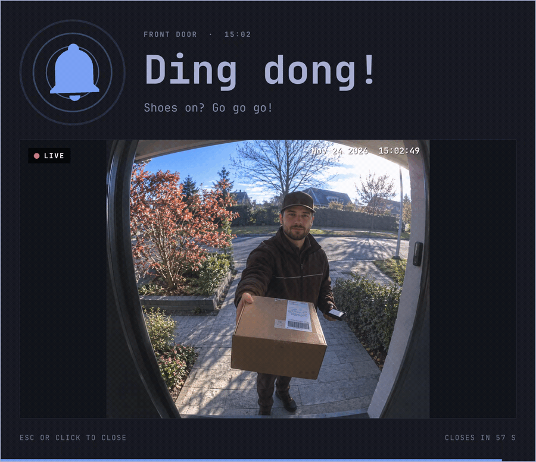
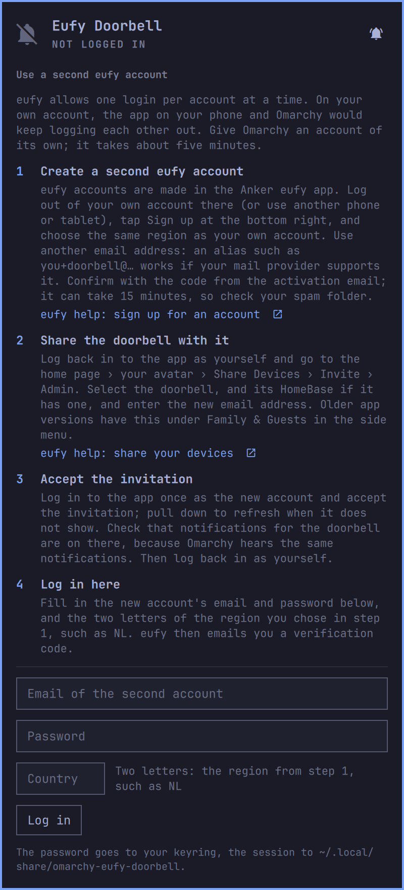

# Eufy Doorbell for Omarchy

Someone presses your eufy video doorbell, and a big ringing bell takes over your screen: a chime, the doorbell's snapshot, and a few seconds later the live camera view. Nobody at the screen? After a minute it closes itself and leaves a "Missed the doorbell" notification with the picture.



The bar gets a bell that shows whether the doorbell is being listened to. Click it to set up; middle-click it to ring the bell as a test.

## You need a second eufy account



eufy allows one active login per account. If this plugin logged in with your own account, the eufy app on your phone and Omarchy would keep logging each other out. Give Omarchy an account of its own and share the doorbell with it. It takes about five minutes:

1. **Create a second eufy account.** eufy accounts are made in the Anker eufy app. Log out of your own account there (or use another phone or tablet), tap *Sign up* at the bottom right, and choose the same region as your own account; eufy only shares between accounts in the same region. Use another email address: an alias such as `you+doorbell@example.com` works if your mail provider supports it. Confirm with the code from the activation email, which can take 15 minutes to arrive. See eufy's help: [Sign up for a eufy account](https://service.eufy.com/article-description/Sign-up-for-A-eufy-Account).
2. **Share the doorbell with it.** Log back in to the app as yourself and go to the home page › your avatar › *Share Devices* › *Invite* › *Admin*. Select the doorbell, and its HomeBase if it has one, and enter the new email address. Older app versions have this under *Family & Guests* in the side menu. See eufy's help: [Share your eufy devices](https://service.eufy.com/article-description/Share-Your-eufy-Devices-With-Your-Family).
3. **Accept the invitation.** Log in to the app once as the new account and accept the invitation; pull down to refresh when it does not show. Check that notifications for the doorbell are on there: the plugin receives the same push notifications the app would. Then log back in as yourself.
4. **Log in in Omarchy.** Click the bell in the bar, fill in the new account's email, password and the two letters of the region you chose in step 1 (such as `NL`), and enter the verification code eufy emails you.

The panel shows the same steps, with the same links.

## Install

Needs Omarchy 4.5 or newer, Node.js 24.5 or newer on your `PATH` (for example `mise use -g node@lts`), and ffmpeg (Omarchy ships it).

```bash
omarchy plugin add https://github.com/davycardinaal/omarchy-eufy-doorbell.git --enable
```

Or, from a local checkout:

```bash
ln -s ~/Projects/omarchy-plugins/eufy-doorbell ~/.config/omarchy/plugins/davycardinaal.eufy-doorbell
omarchy plugin enable davycardinaal.eufy-doorbell --section right
```

Then click the bell and choose **Install eufy-sdk**. That runs `scripts/install-backend.sh`, which installs [eufy-sdk](https://github.com/mega-yfue/eufy-sdk), pinned by `backend/package-lock.json`, into `~/.local/share/omarchy-eufy-doorbell`.

Ring the bell without a doorbell press:

```bash
omarchy-shell davycardinaal.eufy-doorbell ring
```

A test ring shows the live view but no snapshot: eufy only sends the snapshot along with a real press.

## How it works

```
eufy cloud ──push──▶ backend/doorbell.mjs ──JSON line──▶ Service.qml ──▶ Ring.qml (overlay) + chime
                     (eufy-sdk, Node.js)                                   ▲
                     snapshot, live H.264 ──ffmpeg remux──▶ MPEG-TS on 127.0.0.1 ┘
```

- **Fast first.** The backend writes the `ring` line before it does any network work, and the overlay is mounted at shell start (`keepLoaded`), so the bell appears as soon as eufy's push arrives. The snapshot follows in milliseconds and the live view, depending on the doorbell, within about ten seconds.
- **Live view** is the doorbell's own H.264/H.265 stream, remuxed (not transcoded) by ffmpeg and played by the shell from `127.0.0.1` behind a random token. It stops when you close the bell, and after 90 seconds at most, because battery doorbells pay for every second of video.
- **Stays connected.** The backend restarts itself with a growing delay when eufy or the network has a hiccup. When eufy needs you (a new verification code, a password), the bell in the bar shows a crossed-out bell and you get a notification.

## What is stored where

| What | Where |
|---|---|
| Password of the second account | Your desktop keyring (`secret-tool`, service `omarchy-eufy-doorbell`) |
| Email, country, eufy session token, push registration | `~/.local/share/omarchy-eufy-doorbell/` (mode 700) |
| The eufy-sdk runtime | `~/.local/share/omarchy-eufy-doorbell/node_modules` |
| Doorbell snapshots, the latest few | `$XDG_RUNTIME_DIR/omarchy-eufy-doorbell/` (gone at logout) |

## Good to know

- **Unofficial.** eufy has no public API. eufy-sdk speaks the protocol of the current eufy app, and eufy can change that without notice. Its predecessor, eufy-security-client, was retired in 2026 when eufy started shutting down the APIs it used.
- **Your computer has to be on.** The bell rings on this machine only while you are logged in.
- **Logs** go to the shell's journal: `journalctl --user -f _COMM=quickshell | grep eufy-doorbell`.

## Remove

```bash
omarchy plugin remove davycardinaal.eufy-doorbell
secret-tool clear service omarchy-eufy-doorbell account <email-of-the-second-account>
rm -rf ~/.local/share/omarchy-eufy-doorbell
```

Or click **Log out** in the panel first, which forgets the password and the session.

## License

MIT, see [LICENSE](LICENSE). The plugin does not ship its dependencies: [eufy-sdk](https://github.com/mega-yfue/eufy-sdk) (Apache-2.0) is installed from npm on request, and Node.js, ffmpeg and `secret-tool` come from your system.
